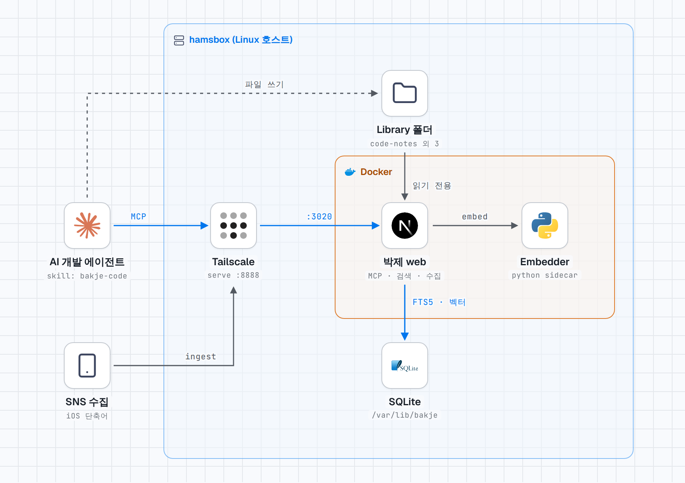

# 현재 동작 구조

어두운 테마: [architecture-dark.png](../assets/architecture-dark.png). 원본 HTML(오프라인에서 열림): [architecture.html](../assets/architecture.html). stack-diagram 스킬로 만들었다.

## 경로

- **검색(파란 선)**: AI 개발 에이전트가 MCP로 `https://hamsbox.badger-viper.ts.net:8888/mcp`에 접속한다. `tailscale serve`가 `:8888`을 `127.0.0.1:3020`으로 넘기고, 이것이 Docker 안 web 컨테이너의 `:3000`이다. web은 SQLite(FTS5와 벡터)를 검색한다.
- **임베딩**: web이 같은 컴포즈의 embedder(Python 사이드카)에 임베딩을 요청한다.
- **코드 등록(점선)**: 에이전트가 호스트의 `/home/leonamin/Library/<이름>`에 파일을 쓰고, web은 그 폴더를 `/library/<이름>`에 읽기 전용으로 마운트해 읽는다. 연결 폴더는 `code-notes`, `opennana`, `ai-costume`, `ai-pose`다. → [결정 020](../decisions/020-code-profile-and-embed-flag.md)
- **SNS 수집**: iOS 단축어가 tailnet으로 `/api/ingest`를 호출한다. → [iOS 단축어 수집](./ios-shortcut.md)

## 근거와 한계

- 확인한 것(2026-11-03): `tailscale serve status`의 `:8888 → 127.0.0.1:3020`, `compose.yml`의 web·embedder·`/var/lib/bakje` 볼륨, 호스트의 `/home/leonamin/Library` 폴더 4개, 위 단축어 문서.
- 그림은 검색·등록·수집 흐름만 다룬다. 캡처 엔진(Playwright), 번역 LLM 호출, UI는 그리지 않았다.
- 에이전트가 호스트 파일에 직접 쓰는 점선은 에이전트가 호스트에서 도는 경우다. 다른 기기의 에이전트는 파일을 쓸 수 없다.
- 그림에 호스트 이름 `hamsbox`가 있다. 외부에 공유하지 않는다.
- 운영 설정이 바뀌면 그림을 직접 고쳐야 한다. 자동으로 갱신되지 않는다.
