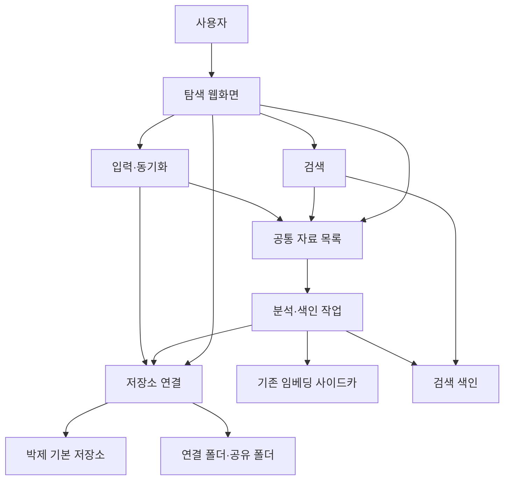

# 통합 자료 탐색 기획: 박제의 서비스 경계

2026-10-28 후속 구현: 공통 목록·연결 저장소·AI 묶음 등록·지속 분석 큐·규격 사본 내보내기를 추가했다. 아래는 전체 목표 구조이며 전부 구현된 것은 아니다. 현재 동작·검증·남은 범위는 [통합 라이브러리](./unified-library.md)를 기준으로 확인한다. 출처, 실제 저장 위치, 컬렉션은 서로 독립적으로 관리한다.

## 1. 무엇을 만드는가

**박제를 개인 자료 보관·탐색 도구로 확장한다.** 게시글, 프롬프트, 이미지, 영상이 어디에 저장되어 있든 한 화면에서 찾고 열 수 있게 한다.

예를 들어 사용자가 “어두운 정원의 패션 이미지”를 검색하면 다음 자료가 함께 나온다.

- 박제로 수집한 X 게시글과 그 안의 이미지
- `~/dev/prompt`에 있는 프롬프트와 결과 이미지
- 박제에 직접 올린 이미지
- 연결된 공유 폴더의 자료

원본 파일을 모두 한 폴더로 옮길 필요는 없다. **자료의 목록, 관계, 검색 방법을 통일한다.**

이 문서는 전체 목표 기획안이다. 아래의 목표 구조, 화면, 상태, 처리 규칙에는 후속 범위가 포함돼 있다. 구현 순서와 완료 조건을 검토하는 기준으로 사용한다.

## 2. 현재 상태와 바뀌는 점

2026-10-28에 개발 폴더의 코드와 설정을 확인했다. 실행 중인 서비스의 상태를 검사하거나 설정을 변경하지는 않았다.

| 항목 | 현재 코드·설정 | 목표 |
|---|---|---|
| 입력 | X·Threads·Reddit 링크 | 기존 링크 + 연결 폴더 + 직접 업로드 |
| 자료의 기준 | 게시글 `source` | 형식에 관계없는 자료 `Item` |
| 미디어 | 게시글에 속하는 `media` | 독립 이미지와 여러 자료가 참조하는 파일 지원 |
| 검색 | SQLite FTS5 + 텍스트·이미지 임베딩 | 공통 자료 목록 전체를 같은 방식으로 검색 |
| 영상 검색 | 포스터 이미지 임베딩 | 후속 단계에서 자막·발언·장면 구간 검색 |
| 운영 | Compose의 `web`, `embedder` | 기존 구성을 바탕으로 확장 |

개발 경로는 `~/dev/bakje`다. 운영 프로그램 경로는 `/opt/bakje`, 운영 데이터 경로는 `/var/lib/bakje`로 구성되어 있다. 이 세 경로의 역할은 유지한다.

기존 [데이터 모델](./data-model.md)은 현재 구조를 설명한다. 이 문서의 목표 구조와 구분해서 읽는다.

## 3. 여기서 말하는 서비스 경계

서비스 경계는 **누가 무엇을 책임지는지 정하는 선**이다. 처음부터 서버나 프로젝트를 여러 개 만드는 뜻은 아니다.

처음에는 하나의 박제 프로젝트에서 기능별 모듈을 나눈다. 모델 실행은 기존 임베딩 사이드카를 재사용한다. 같은 역할의 검색 서비스나 모델 서버를 추가로 띄우지 않는다.



| 경계 | 책임 | 다른 경계에 맡기는 일 |
|---|---|---|
| 입력·동기화 | 링크 수집, 업로드 접수, 폴더 변경 확인, 자료 묶음 해석 | 원본 접근은 저장소 연결, 자료 등록은 공통 목록 |
| 저장소 연결 | 파일 목록 조회, 원본 읽기, 위치 확인, 지원하는 저장소에 파일 저장 | 자료 조합, 임베딩, 검색 순위 |
| 공통 자료 목록 | 자료 ID, 제목, 출처, 구성요소, 파일 참조, 컬렉션, 숨김 상태 | 파일의 실제 읽기, 모델 실행 |
| 분석·색인 작업 | 텍스트 추출, OCR, 영상 분석, 임베딩 요청, 색인 갱신 | 원본 수정, 사용자가 정한 자료 관계 변경 |
| 검색 | 키워드·의미 검색, 필터, 순위 결합, 일치 위치 반환 | 수집 실행, 원본 삭제 |
| 탐색 웹화면 | 전체 보기, 폴더 탐색, 자료 열기, 검색 결과 표시 | DB나 저장 경로에 직접 의존하는 처리 |

자료의 제목과 파일 관계는 공통 자료 목록이 기준이다. 검색 색인은 그 목록에서 만든 복사본이다. 검색 색인을 지워도 원본과 자료 관계는 남아야 한다.

### 경계 사이에서 주고받는 정보

다음은 역할을 설명하는 예시다. 실제 함수명과 API는 구현 단계에서 정한다.

| 요청 | 받는 경계 | 결과 |
|---|---|---|
| “이 폴더에 어떤 파일이 있는가?” | 저장소 연결 | 상대 경로, 크기, 수정 시각, 파일 식별 정보 |
| “이 프롬프트와 이미지들을 한 자료로 등록하라” | 공통 자료 목록 | 자료 ID와 변경 버전 |
| “이 자료가 바뀌었다” | 분석·색인 작업 | 해당 버전을 처리할 작업 기록 |
| “이 조건으로 자료를 찾아라” | 검색 | 자료 ID, 일치한 구성요소·구간, 검색 근거 |
| “이 파일을 열어라” | 저장소 연결 | 파일 내용 또는 접근 오류 |

화면은 내부 파일 경로를 조합해서 파일을 읽지 않는다. 자료·파일 ID로 요청한다. 폴더 연결기는 등록된 루트 안의 파일만 제공한다.

## 4. 저장 위치는 두 종류로 시작한다

### 기본 저장소: 박제가 보관한다

링크에서 수집한 원본과 직접 업로드한 파일을 보관한다. 보관과 백업의 책임은 박제에 있다.

외부 웹 원문이 없어져도 저장된 사본은 유지한다. 사용자 화면에는 원출처와 박제가 보관한 사본을 구분해서 보여준다.

### 연결 저장소: 기존 위치의 파일을 읽는다

`~/dev/prompt` 또는 서버에 마운트한 공유 폴더를 등록한다. 초기에는 읽기 전용으로 연결한다. 원본의 편집·이동·백업은 기존 폴더를 관리하는 쪽이 담당한다.

| 상황 | 기대 동작 |
|---|---|
| 폴더 연결 | 포함 범위를 선택하고 예상 파일·자료 수를 확인한 뒤 등록 |
| 폴더 안의 파일 변경 | 변경된 내용만 분석·색인 갱신 |
| 공유 폴더 접속 실패 | 연결 오류 표시, 기존 자료 목록 유지 |
| 정상 스캔에서 파일 누락 확인 | 원본 없음 표시, 즉시 자료나 파일을 삭제하지 않음 |
| 연결 해제 | 목록에서 해당 저장소 자료를 제외, 외부 원본 유지 |
| 박제로 사본 가져오기 | 별도 동작으로 기본 저장소에 복사, 출처 관계 유지 |

연결만으로는 원본이 백업되지 않는다. 검색용 썸네일과 추출 텍스트를 만들 수 있지만, 그것을 원본 사본으로 표시하지 않는다.

공유 폴더는 우선 호스트에 마운트된 폴더로 취급한다. SMB·NFS 연결과 계정 관리를 웹에서 제공하는 기능은 후속 검토다. Docker에서 연결 폴더를 읽으려면 해당 경로를 읽기 전용으로 전달해야 한다. 웹에 호스트 경로를 입력하는 것만으로 컨테이너가 접근할 수 있는 것은 아니다.

## 5. 공통 자료 목록과 자료 조합

**자료는 사용자가 찾는 단위이고, 파일은 저장하는 단위다.** 하나의 자료는 여러 파일을 포함할 수 있다.

| 이름 | 쉬운 설명 | 기록할 핵심 정보 |
|---|---|---|
| 저장소 `Storage` | 파일이 있는 장소 | ID, 종류, 연결 위치, 읽기·쓰기 지원 여부, 연결 상태 |
| 자료 `Item` | 검색 결과의 한 건 | 안정적인 ID, 제목, 자료 종류, 출처, 수집 시각, 사용자 메모 |
| 구성요소 `Component` | 자료를 이루는 내용 | 역할, 순서, 텍스트 또는 파일 참조, 언어 |
| 파일 `Asset` | 실제 파일 내용 | 내용 해시, MIME, 크기, 하나 이상의 저장 위치 |
| 분석 결과 `Derived` | 원본에서 만든 정보 | OCR·자막·설명·썸네일, 입력 버전, 도구 버전 |
| 검색 단위 `SearchUnit` | 검색에 걸린 작은 부분 | 자료·구성요소 ID, 문단 위치 또는 영상 시간 |
| 컬렉션 `Collection` | 사용자가 묶는 분류 | 이름과 자료 목록 |

저장 위치는 `저장소 ID + 상대 경로`로 표현한다. 파일 이름이나 경로를 자료의 ID로 사용하지 않는다. 파일이 이동해도 같은 자료로 유지할 여지를 둔다.

### 예시 A: 게시글

```text
자료: X에서 수집한 디자인 팁
  ├─ 본문 텍스트
  ├─ 작성자의 이어쓰기 텍스트
  ├─ 첨부 이미지
  └─ 보존용 원본 HTML
```

원본 HTML은 보존·재파싱용이다. 같은 내용을 다시 추출해 검색에 중복 등록하지 않는다.

### 예시 B: 프롬프트와 이미지

```text
자료: 야간 정원 패션 프롬프트 v01
  ├─ 프롬프트 텍스트
  ├─ 참고 이미지
  ├─ 결과 이미지 A — 모델명·생성 설정
  └─ 결과 이미지 B — 모델명·생성 설정
```

현재 1:1인 자료도 1:N 조합을 허용한다. 본문, 참고 이미지, 결과 이미지는 역할로 구분한다. 프롬프트가 변경된 버전은 별도 자료로 만들고 이전 버전과 연결하는 안을 제안한다. 여러 버전을 한 화면에서 비교하는 기능은 후속 단계다.

### 예시 C: 독립 이미지와 알 수 없는 파일

독립 이미지는 이미지 구성요소 하나를 가진 자료다. 가짜 게시글이나 빈 본문을 만들지 않는다.

아직 분석할 수 없는 파일도 이름·경로·MIME·크기로 등록한다. 분석 기능이 추가되면 기존 자료 ID를 유지하면서 검색 정보를 추가한다. 파일 확장자마다 새 테이블을 만들지 않는다. 공통 필드를 유지하고 형식별 설정은 별도 메타데이터로 둔다.

### 중복 제거와 컬렉션

같은 이미지가 다른 게시글에도 나오면 파일 내용과 이미지 분석 결과는 재사용할 수 있다. 게시글의 출처와 문맥은 각각 유지한다. 유사한 이미지라는 이유만으로 자료를 자동 병합하지 않는다.

폴더는 원본의 위치이고, 컬렉션은 사용자의 분류다. 같은 자료를 “디자인 참고”와 “프롬프트” 컬렉션에 넣어도 파일이 두 번 복사되지 않는다.

## 6. 폴더 연결만으로 자료 조합을 알 수는 없다

폴더 연결기는 파일 위치를 알려준다. 프롬프트와 이미지가 한 쌍인지 판단하는 일은 입력·동기화의 자료 해석 규칙이 담당한다.

자료 조합은 다음 순서로 판단한다.

1. 기존 JSONL 또는 매니페스트의 명시적인 관계를 사용한다.
2. 프로젝트에 정의된 폴더·파일 이름 규칙을 사용한다.
3. 관계가 불명확하면 개별 자료로 등록하고 사용자가 묶도록 한다.

`~/dev/prompt/opennana`는 `prompts.jsonl`의 레코드와 미디어 매니페스트의 URL→파일 매핑을 사용한다. `experiments`는 버전·모델별 폴더 규칙을 사용한다. 이 두 입력을 같은 규칙으로 억지로 해석하지 않는다.

원본 JSONL에서 만든 Markdown, 비교 보고서, 임시 파일까지 모두 독립 자료로 넣으면 중복 검색이 생긴다. 연결 설정에서 포함·제외 범위를 정한다. 한 경로에 여러 수집 규칙이 겹치면 대표 규칙을 선택한다.

자료의 재등록은 `연결 소스 ID + 원본 레코드 ID`로 판별한다. 내용 해시는 변경 확인과 파일 중복 제거에 사용한다. 해시가 같다는 이유로 서로 다른 출처의 자료 ID를 하나로 합치지 않는다.

## 7. 자료가 검색 가능해지는 과정

### 링크를 저장할 때

1. 기존 수집기가 원문과 미디어를 가져온다.
2. 기본 저장소에 원본을 보관한다.
3. 공통 자료 목록에 자료와 구성요소를 등록한다.
4. 분석 작업을 기록한다.
5. 텍스트·이미지 색인이 완료되면 검색에 반영한다.

### 폴더를 연결할 때

1. 연결할 루트와 포함·제외 규칙을 선택한다.
2. 파일과 자료 조합의 예상 결과를 확인한다.
3. 원본 위치를 유지한 채 공통 목록에 등록한다.
4. 원본을 읽어 검색용 정보를 만든다.
5. 이후 수동 새로고침과 주기적 스캔으로 변경을 확인한다.

공유 폴더는 실시간 변경 알림이 안정적이지 않을 수 있다. 초기에는 스캔을 기준으로 설계한다. 스캔이 중단되면 미확인 파일을 삭제된 것으로 처리하지 않는다.

### 이미지 한 장을 올릴 때

1. 기본 저장소에 파일을 보관한다.
2. 이미지 구성요소 하나를 가진 자료를 등록한다.
3. 이미지 임베딩을 만든다.
4. 제목·태그·이미지 내용으로 검색할 수 있게 한다.

### 자료와 분석의 상태는 분리한다

자료 등록이 완료되면 분석 중이어도 목록에서 보인다. 파일 이름과 확보한 텍스트로 먼저 검색할 수 있다. 임베딩 서버가 멈춰도 원본 저장과 키워드 검색은 계속 동작한다.

화면에는 원본 상태와 분석 상태를 별도로 표시한다. 예: `원본 있음 / 분석 대기`, `원본 있음 / 분석 실패`, `저장소 연결 안 됨 / 기존 색인 있음`.

공통 목록 변경과 처리할 작업의 기록은 같은 DB 트랜잭션에서 보존하는 안을 제안한다. 작업은 재시작 후 재개하고 중복 실행되어도 결과가 중복되지 않게 한다. 오래된 분석이 늦게 끝나도 새 자료 버전의 색인을 덮어쓰지 않게 한다.

## 8. 임베딩과 검색의 책임

### 자료 전체를 벡터 하나로 만들지 않는다

| 입력 | 검색용 표현 | 결과에서 보여줄 근거 |
|---|---|---|
| 텍스트 | 원문 키워드 + 문단별 임베딩 | 일치한 문장 |
| 이미지 | 이미지 임베딩, 필요 시 OCR·설명 | 일치한 이미지 |
| 텍스트와 이미지 | 각각 색인한 뒤 자료 ID로 연결 | 텍스트 일치인지 이미지 일치인지 |
| 영상 | 초기에는 기존 포스터, 후속은 전사·대표 프레임 | 일치한 발언·장면의 시간 |
| 미지원 파일 | 파일 이름·메타데이터 | 파일 이름과 위치 |

프롬프트에 적힌 내용과 이미지의 실제 모습은 구분한다. OCR·자동 설명도 원문과 구분해 보관한다. 이미지 분석 결과를 사용자가 쓴 설명처럼 취급하지 않는다.

### 임베딩 생성 기록

검색 단위 ID, 입력 해시, 모델 ID·리비전, 벡터 차원, 전처리·분할 규칙 버전, 생성 시각, 상태·오류를 기록한다.

내용과 처리 조건이 같으면 임베딩을 재사용한다. 자료의 제목·관계가 분석 입력에 포함되었다면 그 변경도 입력 해시에 반영한다. 실패한 작업은 오류와 재시도 상태로 남긴다.

모델이 다르면 차원이 같아도 벡터를 직접 비교하지 않는다. 텍스트와 이미지의 직접 비교는 공통 공간을 지원하는 모델 조합에서만 한다. 서로 다른 검색 방식은 순위를 합쳐서 사용한다.

새 모델은 별도 색인 버전으로 만든다. 기존 검색을 유지하면서 처리하고, 누락과 품질을 확인한 뒤 전환한다. 원본과 자료 관계는 다시 만들지 않는다.

### 검색 결과를 구성하는 순서

1. 저장소·형식·컬렉션·숨김 여부로 검색 대상을 정한다.
2. 그 범위에서 키워드와 의미 검색 후보를 찾는다.
3. 구성요소의 일치 결과를 자료 단위로 모은다.
4. 순위를 합치고 일치한 위치를 함께 반환한다.

가능한 한 필터를 적용한 범위에서 후보를 찾는다. 전체 상위 후보를 적게 뽑은 뒤 필터링하면 필요한 자료가 빠질 수 있다. 이미지를 많이 가진 자료가 무조건 유리하지 않도록 자료별 대표 점수를 사용하고 실제 질의로 평가한다.

현재 벡터 검색은 벡터 전체를 순회한다. 먼저 실제 자료 수에서 검색 시간과 메모리를 측정한다. 이후 필요하면 벡터 색인 도구를 도입한다. DB 제품 변경은 이 기획의 선행 조건이 아니다.

## 9. 탐색 웹화면

주요 화면은 세 가지다.

| 화면 | 사용자가 하는 일 | 표시 정보 |
|---|---|---|
| 자료 탐색 | 전체 보기, 검색, 폴더·컬렉션 탐색 | 썸네일, 제목, 저장소, 형식, 검색 일치 근거 |
| 자료 상세 | 본문 읽기, 이미지 보기, 원본 다운로드 | 구성요소 순서, 출처, 관계, 저장 상태 |
| 저장소 관리 | 폴더 연결, 스캔, 연결 해제 | 연결 상태, 마지막 정상 확인 시각, 자료 수, 처리 오류 |

탐색 화면에는 `전체 / 기본 저장소 / 연결 저장소` 범위를 제공한다. 형식·출처·날짜·태그·컬렉션으로 좁힐 수 있게 한다. 검색어 없이 폴더와 썸네일만으로 둘러볼 수도 있다.

자료 카드에는 실제로 일치한 이미지를 우선 표시한다. 첫 번째 첨부 이미지만 고정해서 보여주지 않는다. 상세 화면에서는 일치한 구성요소나 영상 구간으로 이동한다.

브라우저에서 원본 열기는 서버가 제공하는 미리보기·다운로드를 뜻한다. 서버의 파일 탐색기를 사용자 PC에서 직접 여는 기능은 별도 검토다. 저장소 오류가 있으면 마지막으로 확인한 정보임을 표시한다.

## 10. 숨김·제거·삭제를 구분한다

| 동작 | 바뀌는 것 | 원본 파일 |
|---|---|---|
| 자료 숨기기 | 기본 목록·검색에서 제외 | 유지 |
| 연결 해제 | 해당 연결의 자료를 탐색 범위에서 제외 | 외부 원본 유지 |
| 검색 색인 재생성 | 검색용 데이터 갱신 | 유지 |
| 기본 저장소 자료 삭제 | 명시적인 삭제 정책에 따라 자료·참조 정리 | 다른 자료의 참조가 없을 때만 정리 |

외부 연결 폴더의 파일 삭제·이동·이름 변경은 초기 범위에서 제외한다. 연결 끊김을 자료 삭제로 해석하지 않는다.

박제의 기존 미디어 정리 기능도 변경 대상이다. 공통 파일을 도입하면 게시글만 보던 참조 검사를 모든 자료의 참조 검사로 바꿔야 한다. 참조가 남은 파일을 정리하지 않는다.

## 11. 구현 순서와 완료 조건

### 1단계: 게시글을 공통 자료로 연결

- 공통 자료 ID와 구성요소를 추가한다.
- 기존 `source.id`와 새 자료 ID의 매핑을 보존한다.
- 기존 상세 링크·숨김·태그·메모·재수집·미디어 정리가 계속 동작하게 한다.
- 임베딩 모델·입력·처리 버전을 기록한다.

완료 조건: 기존 게시글이 공통 목록에 중복 없이 나타나고, 기존 원본·검색·상세 링크를 사용할 수 있다. 이전 색인을 쓰는 동안 새 색인을 검증할 수 있다.

### 2단계: prompt 폴더 연결

- 읽기 전용 폴더 연결과 수동·주기 스캔을 추가한다.
- OpenNana JSONL·미디어 매핑과 실험 폴더 규칙을 각각 지원한다.
- 포함·제외 규칙과 연결 상태를 제공한다.

완료 조건: 같은 스캔을 반복해도 자료 수가 늘지 않는다. 원본 폴더를 수정하지 않는다. 변경분만 갱신한다. 공유 폴더가 끊겨도 자료가 삭제되지 않는다. 프롬프트와 이미지의 관계가 보존된다.

### 3단계: 직접 업로드와 통합 탐색

- 독립 이미지·텍스트·복합 자료를 등록한다.
- 저장소·형식 필터, 썸네일 보기, 자료 조합 확인을 제공한다.
- 연결 자료의 사본을 기본 저장소로 가져오는 동작을 검토한다.

완료 조건: 같은 검색에서 게시글·프롬프트·독립 이미지를 찾을 수 있다. 사용자가 검색 일치 이유와 원본 보관 위치를 확인할 수 있다.

### 4단계: 영상과 성능 개선

- 영상 전사와 대표 프레임에 시간 정보를 기록한다.
- 자주 쓰는 실제 질의 20~30개와 기대 자료를 정한다.
- 상위 결과의 적중 여부, 검색 시간, 색인 시간, 메모리 사용량을 측정한다.
- 결과에 따라 모델·분할 규칙·벡터 색인을 조정한다.

완료 조건: 영상의 관련 구간을 열 수 있다. 모델·색인 교체 전후의 품질과 비용을 비교할 수 있다. 목표 응답 시간과 자원 한도는 실제 서버 측정 후 정한다.

## 12. 운영과 프로젝트 분리 기준

현재 단계에서는 별도 파일 검색 프로젝트를 만들지 않는다. 박제 내부 모듈과 기존 임베딩 사이드카를 사용한다. 독립 DB나 작업 서버는 필요가 측정된 뒤 검토한다.

컨테이너 설정을 바꾸는 구현 단계에서는 실제 사용자 UID/GID, 볼륨, 네트워크, 재시작 정책을 먼저 확인하고 보존한다. 연결 폴더는 필요한 범위만 읽기 전용으로 전달한다. 이 문서 작성에서는 서비스나 컨테이너를 변경하지 않았다.

나중에 다른 앱들도 같은 자료 목록과 검색 API를 사용해야 한다면, 공통 자료 목록·저장소 연결·분석·검색을 독립 서비스로 묶는 방안을 검토한다. 그때 박제의 게시글 수집과 웹화면은 그 서비스를 사용하는 쪽이 된다. 다른 앱은 DB를 직접 읽지 않고 API를 사용한다.

분리를 쉽게 하려면 지금부터 각 경계가 소유하는 데이터를 정하고, 다른 모듈이 그 테이블을 임의로 수정하지 않게 한다. 실제 분리에는 API, 작업 전달, 데이터 이전 계획이 추가로 필요하다.

## 13. 참고한 오픈소스와 적용 범위

앞선 설계 검토에서 다음 GitHub 프로젝트를 비교했다. 새 서비스 설치나 채택을 결정한 것은 아니다.

| 프로젝트 | 참고할 아이디어 | 박제에서의 사용 방향 |
|---|---|---|
| [Karakeep](https://github.com/karakeep-app/karakeep) | 링크·노트·이미지를 함께 관리 | 게시글 외 입력을 공통 자료로 다루는 방식 참고 |
| [Immich](https://github.com/immich-app/immich) | 사진·영상 중심의 탐색 경험 | 이미지 격자와 미디어 탐색 방식 참고 |
| [pgvector](https://github.com/pgvector/pgvector) | PostgreSQL에서 벡터 검색, 전문 검색과 결합 | 현재 전체 순회 방식의 성능 한계가 확인되면 검토 |

## 14. 구현 전에 정할 세부 사항

다음 항목은 아직 확정하지 않았다. 해당 단계에서 실제 자료로 검토한다.

- 연결 폴더의 초기 포함·제외 경로와 스캔 주기
- 이동한 파일을 같은 자료로 추적하는 기준: 동일 내용이 여러 경로에 있을 때의 처리 포함
- 프롬프트 버전 사이의 연결 방식과 사용자 수정 정보의 보존 규칙
- OCR·이미지 설명을 기본 실행할지, 선택 실행할지
- 기본 저장소 삭제 시 복구 기간과 원본·자료 관계의 백업 범위
- 직접 업로드 파일의 크기 제한: 기존 수집 미디어의 30MB 제한과 별도로 검토

이 항목들이 정해지기 전에도 1단계의 공통 자료 구조와 임베딩 버전 관리부터 착수할 수 있다.
